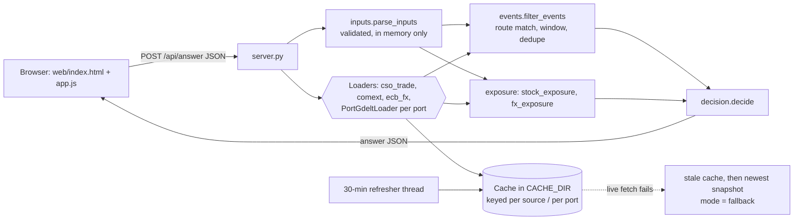
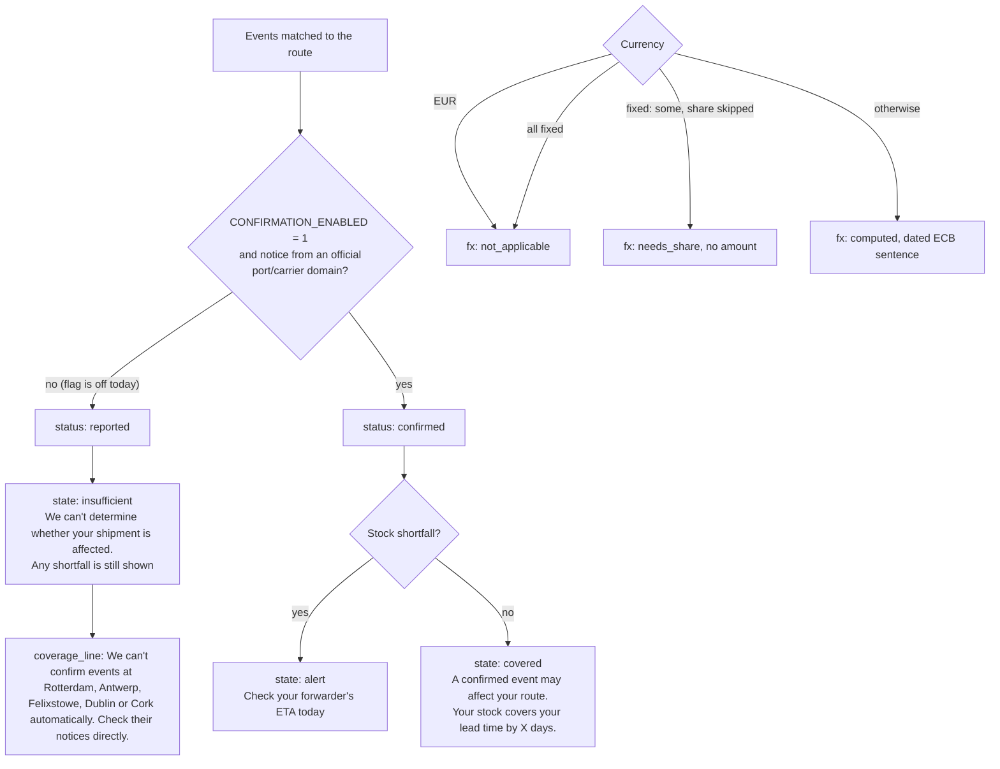

# Corkathon 2026

**A non-commercial showcase** that answers one question for an Irish importer:
*"Will my imports be late or dearer this month?"* It uses real public data
(CSO, Eurostat Comext, ECB, GDELT news) and says plainly when it can't tell.
It is not a commercial product and doesn't give financial advice.

See [CLAUDE.md](CLAUDE.md) for the brief and team rules, and [docs/](docs/) for the detailed docs.

## 1. How it fits together



Request path: the form is posted as JSON to `POST /api/answer` (8 KB cap). `parse_inputs` validates
it, every loader returns a `SourceResult`, `filter_events` keeps news that names a port on the
user's route, `exposure` works out the stock buffer and the FX change, and `decide` builds the
answer card. A background thread refreshes the GDELT cache every `REFRESH_S` seconds (1800).

## 2. Decision logic



- An **alert** needs a route-matched, deduplicated **confirmed** event plus a stock shortfall.
- Confirmation is behind `CONFIRMATION_ENABLED`, which is **off**, so every event is "reported" today.
- FX is a separate card and never feeds the delay answer.

## 3. Data sources

| Source | Module | Endpoint | Licence | Cache expiry |
|---|---|---|---|---|
| CSO imports (TSM06) | `sources/cso_trade.py` | `https://ws.cso.ie/public/api.jsonrpc` (PxStat ReadDataset) | CC BY 4.0 | 31 days |
| Eurostat Comext (DS-045409) | `sources/comext.py` | `https://ec.europa.eu/eurostat/api/comext/dissemination/statistics/1.0/data/DS-045409` | Eurostat free re-use, CC BY 4.0, modifications stated | 31 days |
| ECB reference rates (USD, GBP, CNY, JPY, CHF per EUR) | `sources/ecb_fx.py` | `https://data-api.ecb.europa.eu/service/data/EXR/D.USD+GBP+CNY+JPY+CHF.EUR.SP00.A` | ESCB free reuse, unmodified, source quoted | 1 day |
| GDELT news (one query per port) | `sources/gdelt.py` | `https://api.gdeltproject.org/api/v2/doc/doc` | GDELT terms: reuse with citation; articles themselves not licensed | 30 min |
| Port and carrier advisories | none yet | — | **Not cleared** for reuse (see Known gaps) | — |

Exact licence text lives in each loader and in [docs/sources.md](docs/sources.md).

## 4. Field contract

Every loader returns a `SourceResult` (`sources/base.py`):

| Field | Meaning |
|---|---|
| `source_id`, `endpoint`, `licence` | What was called and under which terms |
| `status` | `ok`, `stale`, `unavailable` or `snapshot` |
| `mode` | `live` or `fallback` (stale cache or saved snapshot) |
| `reference_period` | The period the data covers |
| `published_at` | When the publisher released it, if known |
| `source_updated_at` | When the data itself last changed |
| `checked_at` | When we fetched it (`retrieved_at` is a deprecated alias) |
| `reason`, `records` | Why it fell back, and the parsed rows |

The answer (`decision.decide`) has `state` (`alert`, `covered` or `insufficient`), `headline`,
`inputs`, `delay` (findings, exposure, reading, action), `fx` (status `computed`,
`not_applicable`, `unavailable` or `needs_share`), `sources` (with `mode`,
`source_updated_at` and `checked_at` per row), `dates_line`, `coverage`, `coverage_line`,
`coverage_gaps` and `route_geo`.
`route_geo` lists each port as `{port, role, locode, lat, lon, event}`, using the static table in `ports.py`.

## 5. Privacy rules

- Nothing a user types is written to disk or logged. The server logs only method and path.
- Cache keys hold only public source ids or a single public port name. They never hold a business's combined route, name, stock or invoice details.
- There's no default fixed-rate share. If the user skips it, no amount is shown.
- No trackers, analytics or CDNs. Responses send CSP, `nosniff`, `no-referrer` and `no-store` headers.
- No real business data is tested without Tran's OK and informed consent.

## 6. Wording rules

- Never say "No action needed". Tests enforce this.
- When the app can't tell, it says "We can't determine whether your shipment is affected." and still shows any stock shortfall.
- News is "reported" or "not confirmed". Our reading uses "may".
- Stock is described in words, not with a minus sign: "Stock lasts 21 days. Lead time is 35 days. You're 14 days short."
- FX uses a dated sentence: "Since 7 Oct, the euro cost of the part you haven't fixed would be about X% higher (ECB rate as of 6 Nov). This isn't your bank's rate. Ask for a current quote."
- Dates come in the form "Checked 11:05 UK time. Trade figures are August data, ECB rate as of 6 Nov, port news from 10:40."

## 7. Repo layout

| Path | What it does |
|---|---|
| `src/corkathon/server.py` | Standard-library HTTP server: `/healthz`, `POST /api/answer`, static `web/`, refresher thread |
| `src/corkathon/inputs.py` | Validates the form into `ImporterInputs`, with a redacted repr and plain-language questions |
| `src/corkathon/sources/base.py` | `Loader` and `SourceResult`, the cache in `CACHE_DIR`, the live-to-stale-to-snapshot fallback |
| `src/corkathon/sources/{cso_trade,comext,ecb_fx,gdelt}.py` | One loader per source. `PortGdeltLoader` fetches one port at a time |
| `src/corkathon/sources/registry.py` | Loader registry |
| `src/corkathon/events.py` | `Lane`, route matching, the time window, cross-query dedupe, the confirmation flag |
| `src/corkathon/exposure.py` | Stock buffer and sentence, FX exposure and the dated sentence |
| `src/corkathon/decision.py` | Answer states, coverage gaps, source rows, dates line, `route_geo` |
| `src/corkathon/ports.py` | Static port table (UN/LOCODE codes, approximate coordinates for display only) |
| `src/corkathon/snapshot.py` | Saves dated snapshots to `data/snapshots/<source>/` |
| `web/` | Answer form and card (`index.html`, `app.js`, `styles.css`), plus example answers |
| `tests/` | Offline unit tests against saved real responses (`tests/fixtures/`) |
| `render.yaml` | Render Blueprint |

## 8. Run, test, deploy

You need Python 3.12. Only the standard library is used, so there's nothing to install.

```bash
cp .env.example .env                                     # never commit real values
PYTHONPATH=src python3 -m corkathon.server               # http://localhost:8000
PYTHONPATH=src python3 -m unittest discover -s tests -t .   # or: make test
SNAPSHOT_ONLY=1 PYTHONPATH=src python3 -m corkathon.server  # offline, snapshots only
PYTHONPATH=src python3 -m corkathon.snapshot             # refresh snapshots (or: make snapshot)
```

CI runs the tests and osv-scanner on every pull request.

**Render:** `render.yaml` defines a Starter web service in Frankfurt with health check `/healthz` and a 1 GB disk at `/var/data`. It sets `CACHE_DIR=/var/data/cache`, `REFRESH_S=1800` and `CONFIRMATION_ENABLED=0`, and contains no secrets. Auto-deploy is off. **A deploy needs Tran's explicit approval.**

## 9. Known gaps

- **Confirmation feeds aren't cleared.** Rotterdam PIN and Harwich Haven aren't cleared for reuse, even for this demo, and Cork, Dublin and Antwerp have no machine-readable feed. Confirmation stays off, and all five ports appear in `coverage_gaps`. Nobody contacts ports or carriers without Tran's OK.
- **The route map is a follow-up.** The engine already emits `route_geo`, but the map UI hasn't been built yet.
- **Trade data lags.** CSO and Comext figures run about 2 to 3 months behind.
- **The ECB rate isn't your bank's rate.** The ECB API gives the date but no publication time.
- **The wording hasn't been tested with real importers.** That waits for Tran's OK and informed consent.
