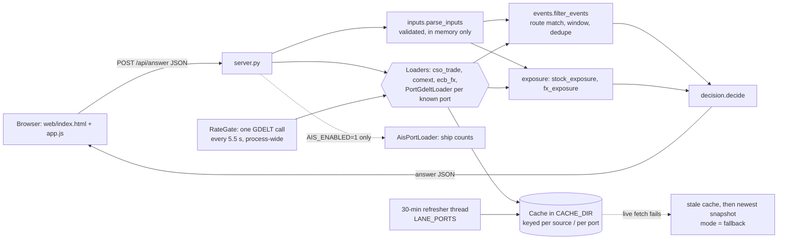
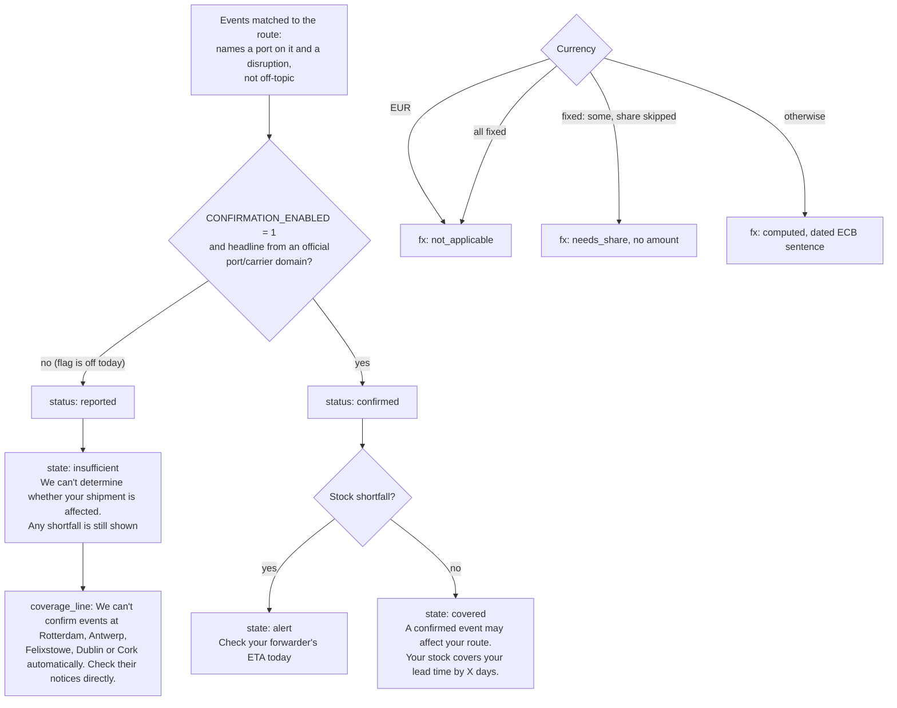

# In Time

*Find out before your stock runs out.*

Team entry for Corkathon 2026 (sponsor: FRAME, Cork): turning live Irish open data into timely, plain-language answers a busy accountant or SME owner can act on.

**In Time** is for Ireland's ~49,600 importers, 98% of them small or medium (CSO, 2022). A small importer enters one shipment route, their invoice currency and how long their stock lasts, and gets a plain-English answer to *"Will my imports be late or dearer this month?"*, with one next step and every source dated.

**Status:** working prototype, **not deployed**. This README describes `main` as of 7 Nov 2026 (after #27, #29 and #30). See [docs/](docs/README.md) for the plan, architecture, data sources and pitch, and [CLAUDE.md](CLAUDE.md) for the brief, judging criteria and team rules.

It's a **non-commercial showcase** on real public data (CSO, Eurostat Comext, ECB, GDELT news), not financial advice.

## Documentation

| Doc | What's in it |
|---|---|
| [Pitch deck (PDF)](docs/pitch/In-Time-pitch.pdf) | The 3-minute pitch |
| [docs/market.md](docs/market.md) | Who it's for, market size, alternatives, who pays, how we'd test it |
| [docs/brand.md](docs/brand.md) | Name, voice and brand |
| [docs/pitch-and-demo.md](docs/pitch-and-demo.md) | Demo flows, script, judge Q&A |
| [docs/architecture.md](docs/architecture.md) | How the code works in more detail |
| [docs/data-sources-guide.md](docs/data-sources-guide.md) | Each data source in plain English |
| [docs/project-plan.md](docs/project-plan.md) | Plan, milestones, decisions, risks |
| [docs/](docs/README.md) | Full docs index |

## Getting started
```bash
cp .env.example .env
make test
PYTHONPATH=src python3 -m corkathon.server   # then open http://localhost:8000
```
On Windows PowerShell, see [docs/contributing.md](docs/contributing.md#on-windows-powershell).


## What you see

- **Landing page:** the question *"Will my imports be late or dearer?"*, a box to ask it in your own words with suggested questions, and the shipment form, beside a real answer (Santos to Cork) captured from the saved 7 Nov data.
- **The answer:** a one-line headline next to a route map, then three answers (stock, route, cost in euro). Each has a status word, how sure we are, and a link to the source row it came from.
- **Things to try on the answer:** stock and lead-time sliders with the order-by arithmetic; ports on the map that open a card with their news status and official notices; the ECB rate as a chart you can scrub, with a "what if you'd fixed" share slider and your invoice amount.
- **Shipments book:** several shipments on one page (for an accountant with many clients), check them all again, and an optional 30-minute re-check while the tab stays open, with "What changed".
- **Track it yourself:** a container number (ISO 6346 check digit) links to the carrier's tracking page; a ship name or IMO number links to public trackers. You can also compare your bank's quote with the ECB rate and copy a plain-text summary.

The visual design is being reworked, so screenshots in `docs/pr-shots/` may not match the current page.

## How it fits together



Request path: the form is posted as JSON to `POST /api/answer` (8 KB cap). `parse_inputs` validates
it, every loader returns a `SourceResult`, `filter_events` keeps news that names a port on the
user's route, `exposure` works out the stock buffer and the FX change, and `decide` builds the
answer card. News is only searched for ports in our table (`ports.py`); unknown port names never
reach GDELT and come back in `news_ports.unknown`. Every live GDELT call waits for one shared slot
(at most `REQUEST_GATE_WAIT_S`, 6 s) and otherwise falls back to cache or snapshot. A background
thread refreshes the GDELT cache for `LANE_PORTS` every `REFRESH_S` seconds (1800).

## Decision logic



- An **alert** needs a route-matched, deduplicated **confirmed** event plus a stock shortfall.
- Confirmation is behind `CONFIRMATION_ENABLED`, which is **off**, so every event is "reported" today.
- FX is a separate card and never feeds the delay answer.

## Data sources

| Source | Module | Endpoint | Licence | Cache expiry |
|---|---|---|---|---|
| Met Éireann weather warnings | `sources/met_warnings.py` | `https://www.met.ie/Open_Data/json/warning_IRELAND.json` | Met Éireann CC BY 4.0 (verbatim, expiry-filtered, data.gov.ie High Value Dataset) | 15 min |
| Nager.Date public holidays | `sources/holidays.py` | `https://date.nager.at/api/v3/PublicHolidays/{year}/{CC}` | MIT licence | 7 days |
| CSO imports (TSM06) | `sources/cso_trade.py` | `https://ws.cso.ie/public/api.jsonrpc` (PxStat ReadDataset) | CC BY 4.0 | 31 days |
| Eurostat Comext (DS-045409) | `sources/comext.py` | `https://ec.europa.eu/eurostat/api/comext/dissemination/statistics/1.0/data/DS-045409` | Eurostat free re-use, CC BY 4.0, modifications stated | 31 days |
| ECB reference rates (24 currencies per EUR; the saved snapshot holds USD, GBP, CNY, JPY, CHF only) | `sources/ecb_fx.py` | `https://data-api.ecb.europa.eu/service/data/EXR/D.<24 codes>.EUR.SP00.A` | ESCB free reuse, unmodified, source quoted | 1 day |
| GDELT news (one query per port) | `sources/gdelt.py` | `https://api.gdeltproject.org/api/v2/doc/doc` | GDELT terms: reuse with citation; articles themselves not licensed | 30 min |
| Official carrier and port headlines (confirmation) | `events.py` (`CONFIRMING_DOMAINS`, via GDELT) | GDELT, limited to 18 official domains | **Reuse terms not recorded**, so `CONFIRMATION_ENABLED` is off | 30 min |
| AISHub ship counts (behind `AIS_ENABLED`) | `sources/ais.py` | `https://data.aishub.net/ws.php` | Members-only, non-commercial: **terms to confirm** before public display; counts only, never names or positions | 15 min (one call a minute at most) |

Exact licence text lives in each loader and in [docs/sources.md](docs/sources.md).

## Field contract

Every loader returns a `SourceResult` (`sources/base.py`):

| Field | Meaning |
|---|---|
| `source_id`, `endpoint`, `licence` | What was called and under which terms |
| `status` | `ok`, `stale`, `unavailable` or `snapshot` |
| `mode` | `live` or `fallback` (stale cache or saved snapshot) |
| `reference_period` | The period the data covers |
| `published_at` | When the publisher released it, if known |
| `source_updated_at` | When the data itself last changed |
| `checked_at` | When we fetched it (`retrieved_at` is a deprecated alias) |
| `reason`, `records` | Why it fell back, and the parsed rows |

The answer (`decision.decide`) has `state` (`alert`, `covered` or `insufficient`), `headline`,
`inputs`, `delay` (findings, exposure, reading, action), `fx` (status `computed`,
`not_applicable`, `unavailable` or `needs_share`; when `computed` it also carries `rate_then`,
`rate_now`, their dates, `unfixed_share` and `series`, the daily ECB rate for the chart), `sources`
(with `mode`, `source_updated_at` and `checked_at` per row), `dates_line`, `coverage`,
`coverage_line`, `coverage_gaps` and `route_geo`. The server adds `news_ports` (`checked`, with
status per port, and `unknown`) and, only with `AIS_ENABLED=1`, `ais` (counts per port).
`route_geo` lists each port as `{port, role, locode, lat, lon, event}`, using the static table in `ports.py`.

## Privacy rules

- Nothing a user types is written to disk or logged. The server logs only method and path.
- Cache keys hold only public source ids or a single public port name. They never hold a business's combined route, name, stock or invoice details.
- There's no default fixed-rate share. If the user skips it, no amount is shown.
- The shipments book and the 30-minute re-check live in the browser tab only.
- No trackers, analytics or CDNs; fonts are self-hosted. Responses send CSP, `nosniff`, `no-referrer` and `no-store` headers.
- No real business data is tested without Tran's OK and informed consent.

## Wording rules

- Never say "No action needed". Tests enforce this.
- When the app can't tell, it says "We can't determine whether your shipment is affected." and still shows any stock shortfall.
- News is "reported" or "not confirmed". Our reading uses "may".
- Stock is described in words, not with a minus sign: "Stock lasts 21 days. Lead time is 35 days. You're 14 days short."
- FX uses a dated sentence: "Since 7 Oct, the euro cost of the part you haven't fixed would be about X% higher (ECB rate as of 6 Nov). This isn't your bank's rate. Ask for a current quote."
- Dates come in the form "Checked 11:05 UK time. Trade figures are August data, ECB rate as of 6 Nov, port news from 10:40."

## Repo layout

| Path | What it does |
|---|---|
| `src/corkathon/server.py` | Standard-library HTTP server: `/healthz`, `POST /api/answer`, static `web/`, refresher thread |
| `src/corkathon/inputs.py` | Validates the form into `ImporterInputs`, with a redacted repr and plain-language questions |
| `src/corkathon/sources/base.py` | `Loader` and `SourceResult`, the cache in `CACHE_DIR`, the live-to-stale-to-snapshot fallback |
| `src/corkathon/sources/{cso_trade,comext,ecb_fx,gdelt}.py` | One loader per source. `PortGdeltLoader` fetches one port at a time through the shared `RateGate` |
| `src/corkathon/sources/ais.py` | AISHub ship counts per port, behind `AIS_ENABLED` |
| `src/corkathon/sources/registry.py` | Loader registry |
| `src/corkathon/events.py` | `Lane`, route matching, the time window, cross-query dedupe, the confirmation flag |
| `src/corkathon/exposure.py` | Stock buffer and sentence, FX exposure and the dated sentence |
| `src/corkathon/decision.py` | Answer states, coverage gaps, source rows, dates line, `route_geo` |
| `src/corkathon/ports.py` | Static port table (UN/LOCODE codes, approximate coordinates for display only) |
| `src/corkathon/snapshot.py` | Saves dated snapshots to `data/snapshots/<source>/` |
| `web/` | The page (`index.html`, `app.js`, `styles.css`), self-hosted fonts, the captured answer images in `img/`, and example answers in `examples/` |
| `docs/` | Plan, architecture, sources and licences, pitch, market, brand ([index](docs/README.md)) |
| `tests/` | Offline unit tests against saved real responses (`tests/fixtures/`) |
| `render.yaml` | Render Blueprint |

## Run, test, deploy

You need Python 3.12. Only the standard library is used, so there's nothing to install.

```bash
cp .env.example .env                                     # never commit real values
PYTHONPATH=src python3 -m corkathon.server               # http://localhost:8000
PYTHONPATH=src python3 -m unittest discover -s tests -t .   # or: make test
SNAPSHOT_ONLY=1 PYTHONPATH=src python3 -m corkathon.server  # offline, snapshots only
PYTHONPATH=src python3 -m corkathon.snapshot             # refresh snapshots (or: make snapshot)
```

CI runs the tests and osv-scanner on every pull request.

| Setting | Default | What it does |
|---|---|---|
| `PORT` | `8000` | Server port |
| `CACHE_DIR` | `.cache` | Where source responses are cached |
| `REFRESH_S` | `1800` | How often the background thread refreshes `LANE_PORTS` news |
| `LANE_PORTS` | `Rotterdam,Antwerp,Felixstowe,Dublin,Cork` | Ports kept warm by the refresher |
| `REQUEST_GATE_WAIT_S` | `6` | Longest an answer waits for a GDELT slot before using the cache |
| `SOURCE_TIMEOUT_S` | `20` | Timeout for each live fetch |
| `SNAPSHOT_ONLY` | off | `1` reads saved snapshots only, no network (`SNAPSHOT=1` still works) |
| `SNAPSHOT_DATE` | newest | Pin a snapshot day, e.g. `2026-11-07` |
| `CONFIRMATION_ENABLED` | off | Official carrier and port headlines can confirm an event |
| `AIS_ENABLED` + `AISHUB_USERNAME` | off | Ship counts near each port |

**Render:** `render.yaml` defines a Starter web service in Frankfurt with health check `/healthz` and a 1 GB disk at `/var/data`. It sets `CACHE_DIR=/var/data/cache`, `REFRESH_S=1800`, `LANE_PORTS`, `CONFIRMATION_ENABLED=0` and `AIS_ENABLED=0`, and contains no secrets (`AISHUB_USERNAME` would go in the dashboard, not the file). It has not been deployed. Auto-deploy is off. **A deploy needs Tran's explicit approval.**

## Limits

### What it does well
- **Several shipments at once.** An accountant can check every client's shipment on one page and re-check them all; nothing is kept after the tab closes.
- **Checks your route, not the whole world.** Only news naming a port on the route you entered, inside your dates, is shown. We never guess your route.
- **Separates rumour from confirmation.** A news story is shown as "reported". It only counts as "confirmed" when a carrier or port authority's own notice names the event and a place on your route.
- **Says when it doesn't know.** It never says "No action needed". When it can't tell, it says so, still flags a stock shortfall, and links to the official notices of the ports it can't check.
- **Ties it to your business.** Compares your stock with your order lead time, and works out the exchange-rate effect on the part of your invoice you haven't fixed.
- **Says where every number came from and how fresh it is.** Every figure carries its source, period and when we checked it.
- **Keeps your information private.** What you type is never saved, cached or logged.
- **Doesn't break in a demo.** If a live source is down, it uses the last saved copy and says so.
- **Tested.** 100 offline tests run on every pull request.

### Where it breaks
- **We can't see your shipment.** A confirmed port problem on your route may or may not affect your container; we tell you to check with your forwarder. The page links your carrier's tracking page from your container number, so that check is one click.
- **News is a signal, not proof.** A headline must name a port on your route *and* a disruption, and off-topic stories (football, hurling, wine) are dropped, but quiet delays may never be reported.
- **Confirmation is built but off by default.** With `CONFIRMATION_ENABLED=1`, a headline from an official carrier or port site (found through GDELT's domain filter) that names a disruption and a port on your route counts as "confirmed". It stays off on the public site until the reuse terms of those pages are recorded.
- **Few confirming sources.** "Confirmed" relies on a fixed list of major carriers and ports (18 domains); smaller ones can only ever show as "reported".
- **Holiday buffers are rules of thumb.** Chinese New Year (14 days) and holiday dispatch/clearance buffers reflect real-world shipping slowdowns, but supplier factory schedules vary. All rule delays are explicitly labelled with their assumptions.
- **Met warnings look ahead ~48 hours** and cover Irish destination ports only (Cork, Dublin). They reflect official civil protection warnings, not open-ocean sea conditions.
- **National holidays only, not regional closures.** Nager.Date provides country-wide public holidays; individual factory or municipal holidays are not included.
- **The date slider ignores news and FX.** Asking on another date recomputes order timing based on holidays and lead time only; news and currency rates reflect current data.
- **Not your bank's rate.** Currency figures use ECB reference rates, published once a working day. You can type your bank's quote to see its margin against the reference rate.
- **24 foreign currencies** from the ECB, but our saved copy (used when the ECB is unreachable) holds only the dollar, sterling, yuan, yen and Swiss franc.
- **Ship positions are counts, not tracks.** With `AIS_ENABLED=1` and an AISHub account, the route answer shows how many ships are at anchor or moving near each port. We never show names or positions; for a single ship we link public trackers.
- **31 ports known.** News is only searched for ports in our table; we say so when you type another.
- **Watching needs the page open.** "Check again every 30 minutes" runs in your browser tab, because we never store your shipment.
- **Trade statistics lag** about 2–3 months, so they're shown as background only.

### What more time would add
- Confirm the reuse terms of carrier and port pages and of AISHub, then switch both flags on.
- More confirming sources and ports: canal authorities, smaller carriers, a bigger port table.
- Alerts that don't need the page open, without storing anyone's shipment (for example, a calendar file the user keeps).
- Testing with real importers and accountants.
